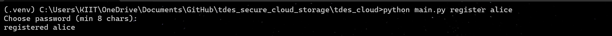
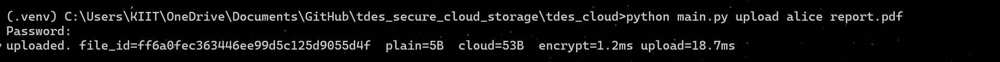
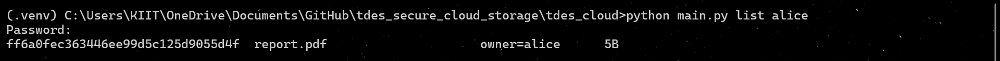
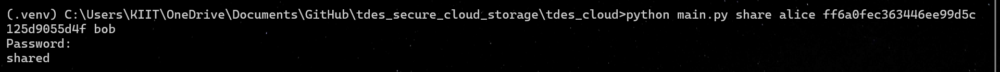
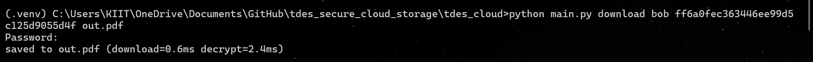
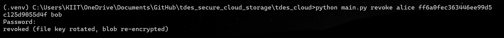
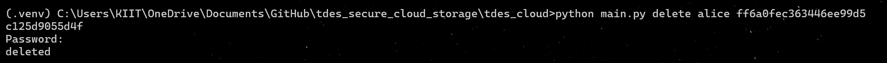
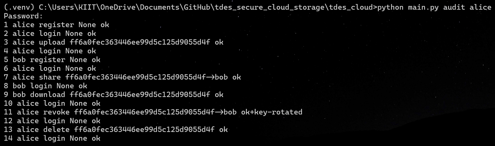

# Triple DES (3DES) Secure Cloud File Storage System

Files are encrypted on the client with **3DES-CBC + HMAC-SHA256 (Encrypt-then-MAC)** before upload.
The cloud only stores opaque, randomly named blobs; only authorized users can recover the file key.

## Setup
```
pip install -r requirements.txt
python security_tests.py -v     # 31 security/correctness tests
python benchmark.py             # writes results/benchmark.csv + .png
python main.py register alice   # CLI (see main.py docstring)
```

## CLI screenshots

The following screenshots demonstrate the main user and file-management workflows.

### 1. Register a user


### 2. Upload a file


### 3. List a user's files


### 4. Share a file with another user


### 5. Download a file


### 6. Revoke access


### 7. Delete a file


### 8. View the audit log


## Architecture
| Module | Role |
|---|---|
| `securecloud/crypto_engine.py` | Streaming 3DES-CBC, PKCS#7, HMAC-SHA256, per-file keys, verify-before-decrypt |
| `securecloud/cloud_backend.py` | Cloud abstraction; `LocalCloudBackend` (folder + latency/bandwidth simulator). Swap in S3/Azure/GCS by implementing `put/get/delete` |
| `securecloud/database.py` | SQLite: users, files, per-user wrapped keys, audit log |
| `securecloud/service.py` | Register/login (scrypt, lockout), upload, download, share, revoke (+key rotation), delete, list |
| `main.py` | CLI |
| `benchmark.py` | Performance evaluation |
| `security_tests.py` | Security verification |

### Key management
```
password --scrypt--> password hash (login)          password --scrypt+AES--> protects RSA-2048 private key
random 3DES key (24 B) + HMAC key (32 B) per file --RSA-OAEP(public key of each authorized user)--> access table
```
Sharing = wrapping the file key for another user's public key. Revocation = delete wrapping **and** re-encrypt the blob under a fresh key, so a revoked user's cached key is useless.

### Blob format
`"3DSC" | version | IV(8) | ciphertext | HMAC-SHA256(len(aad)|aad|header|ciphertext)` with AAD = file id.
Overhead is constant: 13 + 32 bytes + 1–8 bytes padding (<= 53 bytes total).

## Security verification matrix
| Threat | Defence | Tests |
|---|---|---|
| Unauthorized access | per-user wrapped keys, owner-only share/delete/revoke, identical error for "missing" vs "forbidden", audit log | `TestA_*` |
| File tampering | HMAC verified before decryption; IV/ciphertext/tag/truncation/append/blob-swap all rejected; no partial plaintext written | `TestB_*` |
| Brute force | online: lockout after N failures + scrypt; offline: random 168-bit-nominal (~112-bit effective) per-file key, wrong keys never pass MAC | `TestC_*` |
| Data leakage | no plaintext/filenames in cloud, random key+IV per file (same file -> different ciphertext), CBC hides repeated blocks, private key encrypted at rest, temp files cleaned | `TestD_*` |

## Performance (pure PyCryptodome, 3 runs each; see results/benchmark.csv)
Encrypt/decrypt throughput is ~9-11 MB/s (3DES is slow by design: 48 DES rounds per 8-byte block).
Upload/download time is dominated by the network model, not crypto, for small files. Storage overhead is a fixed 53 bytes (5% at 1 KB, <0.01% at 1 MB+).

## Limitations
* **3DES is deprecated.** NIST disallowed it for new encryption after 2023 (SP 800-131A/SP 800-67). Its 64-bit block enables the Sweet32 birthday attack, mitigated here by a fresh key per file and a 1 GiB per-file cap.
  Effective strength is ~112 bits. For production, replace `crypto_engine.py` with AES-256-GCM; the rest is unchanged.
* The "cloud" is a local folder; metadata (file names) sit in the SQLite DB, not the bucket.
* Revocation cannot un-leak plaintext a user already downloaded.
* Metadata DB is trusted for access control; a malicious DB admin could add themselves to the access table but still cannot decrypt without a file key wrapped for them by an authorized user.
